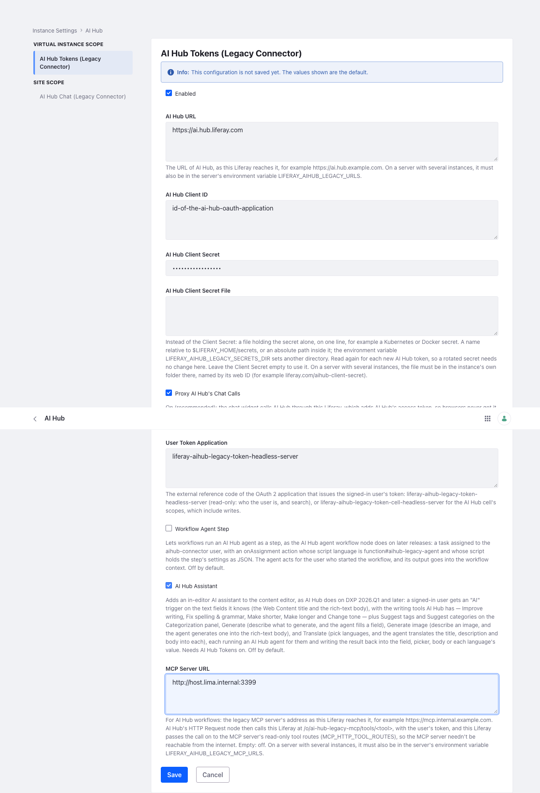
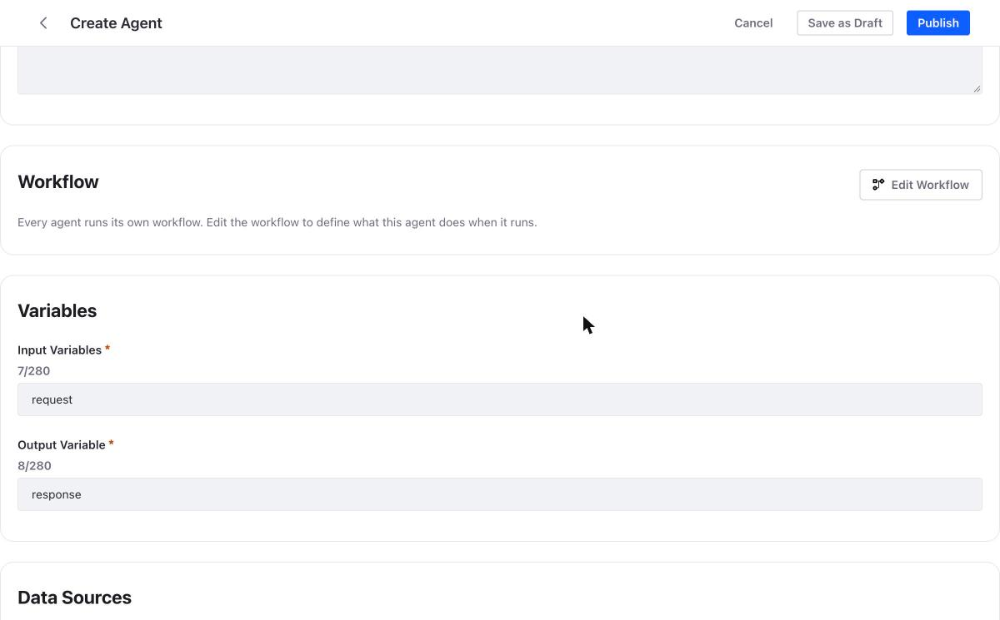
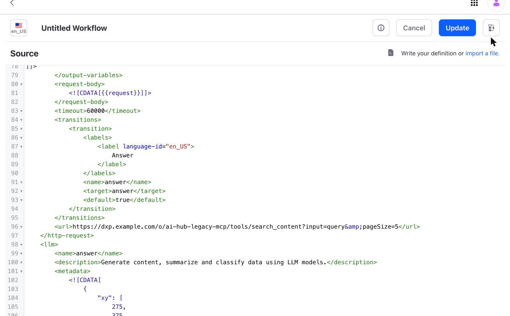
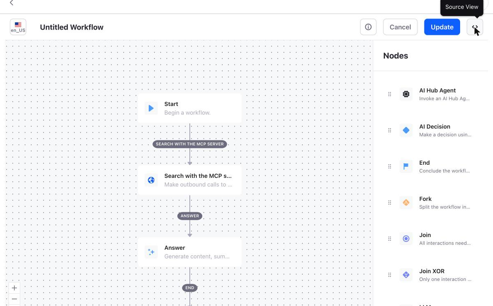
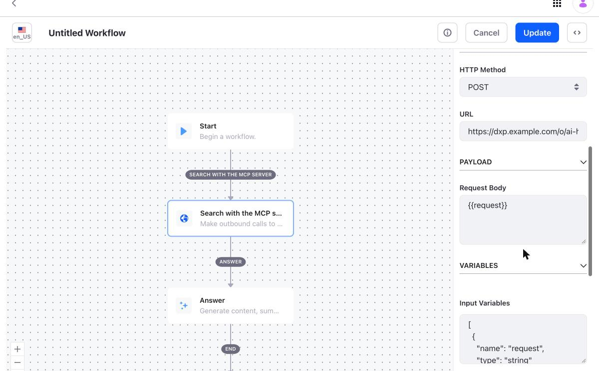
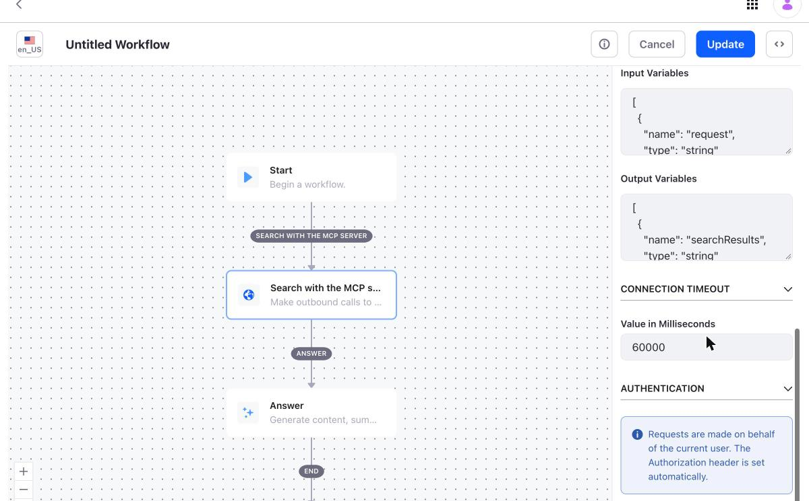

# AI Hub Workflows and the MCP Server (pilot)
{: .no_toc }

An AI Hub agent's workflow can call the [Liferay Legacy MCP](../liferay-legacy-mcp/) server's tools, as the user chatting, through the connector. A stopgap until AI Hub can call MCP servers itself.
{: .fs-5 .fw-300 }

1. TOC
{:toc}

## How It Works

AI Hub's **HTTP Request** node sends the user's token only to your Liferay DXP's own address. So the node calls the connector on your DXP, which passes the call on to the MCP server with that token:

```text
AI Hub agent workflow
  HTTP Request node ── POST {DXP}/o/ai-hub-legacy-mcp/tools/search_content?input=query  (the user's token)
        │
        ▼
Your DXP, the connector (2.10.0 and later)
  checks the user's token, passes the call on with it
        │
        ▼
Liferay Legacy MCP server (1.4.0 and later) ── POST /tools/search_content
  checks the token with your DXP, runs the tool, as that user
```

The MCP server doesn't need to be on the internet: only your DXP calls it.

{: .warning }
For AI Hub users, the MCP server reads Liferay with its own connection, not as each person: anyone you allow can read what that connection can. For this pilot, give the server a read-only connection limited to what every chatbot user may see, and route only the tools you need. Tool results go into AI Hub's model, as with AI Hub's own Liferay Search.

## Step 1: The MCP Server

Run the MCP server over HTTPS next to your DXP (see [For Services and People](../liferay-legacy-mcp/installing/http.html)), with:

| Setting | Value |
| --- | --- |
| `MCP_HTTP_TRUSTED_ISSUER_URL` | Your DXP, as the server reaches it |
| `MCP_HTTP_TRUSTED_ISSUER_CHECK` | `userinfo` |
| `MCP_HTTP_TRUSTED_ISSUER_ALLOW` | Who may use it: emails, `@domain` entries, user IDs, or `*` |
| `MCP_HTTP_TOOL_ROUTES` | The tools workflows may call, for example `search_content` |

It names the routed tools when it starts: `tool routes (POST /tools/<name>, read-only): search_content`. Only read-only tools can be routed, unless approval links are on, in which case a write tool only returns a link the person approves.

## Step 2: The Connector

In **Instance Settings → AI Hub → AI Hub Tokens (Legacy Connector)**, with the tokens configured as in [Configuration](configuration.html), set **MCP Server URL** to the MCP server's address as your DXP reaches it. Optionally, **MCP Server Tools** lists the only tools passed on.



With the [installer](installing.html#in-one-command-2110-and-later), set `MCP_SERVER_URL` and `MCP_SERVER_TOOLS` instead. On a server with several instances, the URL must also be in the environment variable `LIFERAY_AIHUB_LEGACY_MCP_URLS`.

## Step 3: The Agent in AI Hub

1. In AI Hub's **Agent Builder**, click **Create New Agent**, give it a title and description, and set **Input Variables** to `request` and **Output Variable** to `response`.

    

1. Click **Edit Workflow**, then the source view (`<>`). Replace what's there with [legacy-mcp-tool-workflow.xml](assets/downloads/legacy-mcp-tool-workflow.xml), keeping the `<name>` the editor gave the workflow (in place of `REPLACE_WITH_EDITOR_NAME`) and putting your DXP's address in place of `REPLACE_WITH_DXP_URL`.

    

1. Back in the diagram view, the workflow searches with the MCP server, then answers from what it found:

    

1. The **Search with the MCP server** node posts the user's question, `{{request}}`, as the whole body, to `…/tools/search_content?input=query&pageSize=5`. As the whole body, the question can't change the tool's other arguments. Change `pageSize`, or add `site=<site>`, in the URL.

    

    AI Hub adds the user's token itself, because the URL is your DXP's:

    

1. Click **Update**, then **Publish** the agent, and point a chatbot at it.

## What Gets Refused

- A call without a user token issued by your DXP's connector, or with another application's token: 401 at the connector.
- A path other than `/tools/<name>`: 404 at the connector. A tool the MCP server doesn't route, or that **MCP Server Tools** doesn't list: 404.
- An argument the tool doesn't have, or one given twice: 400.

## Checked

On DXP 2025.Q1.29 with the connector and the MCP server on the same network, calling the connector as AI Hub's HTTP Request node does: a search returned the site's article as the user; a question containing quotes and arguments stayed the search text; no token, another application's token, an unrouted tool and a path outside `/tools/` were refused. Not yet run from AI Hub's cloud, which needs the DXP on an address AI Hub can reach.
