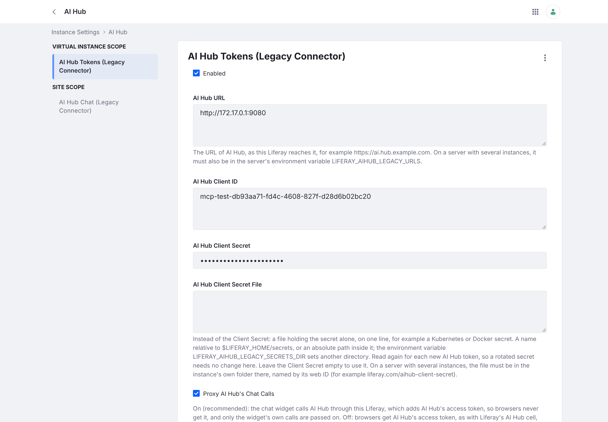

# Configuration
{: .no_toc }

1. TOC
{:toc}

AI Hub Tokens is **per instance** (company) and **off until configured** — while off or incomplete the token endpoint answers 404, exactly as a DXP without the cell does. Set it in **Instance Settings → AI Hub → AI Hub Tokens (Legacy Connector)**, or with a configuration file.

{: .screenshot }

## Connect AI Hub

Fill in:

- **AI Hub URL** — your AI Hub service URL, as this Liferay reaches it.
- **Client ID / Client Secret** — of an OAuth application on AI Hub for this Liferay.
- **Enabled** — turn token issuing on.

With a configuration file instead of the UI, copy the package's `.config.sample` to:

```
$LIFERAY_HOME/osgi/configs/com.lgsapac.aihub.legacy.token.configuration.AIHubTokenConfiguration.scoped~token.config
```

and set `aiHubURL`, `aiHubClientId`, `aiHubClientSecret`, `companyId` and `enabled=B"true"`. Make it readable only by Liferay.

## Keep the secret out of the configuration

Instead of the client secret, set **`aiHubClientSecretFile`** (the **AI Hub Client Secret File** field) to a file holding the secret alone, on one line, in `$LIFERAY_HOME/secrets` (for example a Kubernetes or Docker secret mounted there). The environment variable `LIFERAY_AIHUB_LEGACY_SECRETS_DIR` sets another directory.

- Only files inside that directory are read (links and `..` are resolved first), up to 1 KB and one line — so an administrator who can edit the setting can't make the module send another file of the server to AI Hub.
- It's read again for each new AI Hub token, so a rotated secret needs no configuration change.
- If the plain Client Secret is also set, it wins.

## Servers with several instances

Where more than one instance runs and their administrators aren't all trusted with each other's secrets:

- **Secret file** must be in the instance's own folder, `secrets/<web ID>/` (for example `secrets/liferay.com/aihub-client-secret`). A file directly in `secrets/` is refused.
- **AI Hub URL** must be one of the URLs in the environment variable `LIFERAY_AIHUB_LEGACY_URLS` (comma-separated), which the server operator sets. Otherwise no credentials are sent.

On a single-instance server neither restriction applies.

## The cell's scopes (optional)

By default the user token is **read-only** (user + search). AI Hub features that act on this Liferay as the user through other APIs — taxonomy, objects, bulk and batch — need the broader scopes the cell's own application grants. Deploy `liferay-aihub-legacy-token-cell` alongside the default and set **User Token Application** (`userTokenApplicationExternalReferenceCode`) to `liferay-aihub-legacy-token-cell-headless-server`; clear it to go back.

| Scope | Default | Cell scopes |
|---|---|---|
| `Liferay.Headless.Admin.User.everything.read` | ✓ | ✓ |
| `Liferay.Portal.Search.REST.everything.read` | ✓ | ✓ |
| `Liferay.Headless.Admin.Taxonomy.everything.read` | | ✓ |
| `Liferay.Object.Admin.REST.everything.read` | | ✓ |
| `Liferay.Bulk.REST.everything.write` | | ✓ |
| `Liferay.Headless.Batch.Engine.everything` | | ✓ |

{: .note }
The cell token can **change** things as the user, and AI Hub holds it for the chat, so use it only where AI Hub's agents should act on this Liferay directly. The CMP scopes the cell also grants are left out because those APIs don't exist on these releases.

## Check it

- `POST /o/ai-hub-cell/v1.0/authorization-tokens` as a guest returns **403** (404 means it's off or not configured).
- Once Chat or the Assistant is on, from a signed-in page with `x-csrf-token: Liferay.authToken` it returns `accessToken`, `serviceURL` and `userToken`.
- A **503** means it couldn't get a token from AI Hub; Liferay's log says why, without the secret.

Next: turn on the [Chat Widget](chat.html) and the [In-editor Assistant](in-editor-assistant.html).
