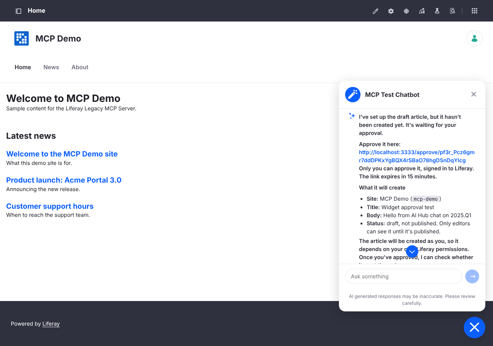

# Chat Widget
{: .no_toc }

1. TOC
{:toc}

AI Hub Chat puts AI Hub's chat widget on every page — the same thing Click to Chat's AI Hub provider does on 2026.Q1 and later, through the same bottom-of-page include.

{: .screenshot }

## Turn it on

As an administrator, open **Control Panel → Instance Settings → AI Hub → AI Hub Chat (Legacy Connector)**, tick **Enabled**, enter the **Chatbot External Reference Code** (from AI Hub's Chatbots page), and Save. Every site's pages then load AI Hub's widget.

| Setting | Notes |
|---|---|
| **Enabled** | Off by default. |
| **Chatbot External Reference Code** | From AI Hub's Chatbots page. |
| **Guest Users Allowed** | Off by default — guests get no widget. On, guests get it and chat anonymously, if the chatbot allows guest access in AI Hub. |
| **AI Hub URL** | Optional. Empty uses AI Hub Tokens' URL; set it only if browsers reach AI Hub at a different address than the server does. |

## Site scope

The settings are **site-scoped**, like Liferay's own site settings: set in Instance Settings they apply to every site; a site's **Site Settings → AI Hub** overrides them for that site (another chatbot, or off). Nothing is added in the Control Panel or in pop-ups, and nothing where Click to Chat already has its AI Hub provider — so the widget is never added twice.

## How it behaves

- The chat answers **as the signed-in user** — the connector sends a per-user token, which AI Hub forwards back to the DXP, so reads follow that user's permissions.
- With the MCP server connected, the chatbot's agent can use its tools; writes come back as **approval links** the user confirms while signed in (shown in the screenshot above).
- With the proxy on (the default), the widget's files still come from AI Hub but its calls go to this Liferay; see [Security](security.html) and [In-editor Assistant → The proxy](in-editor-assistant.html#the-proxy).
