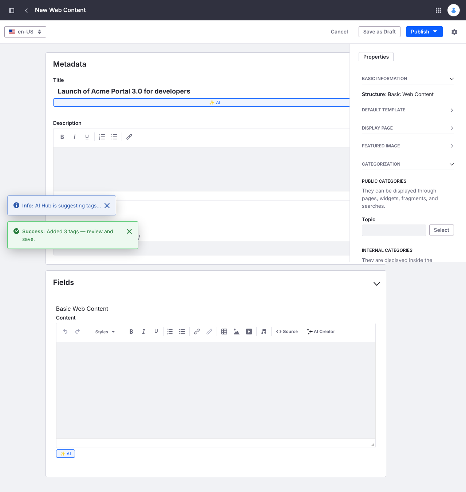
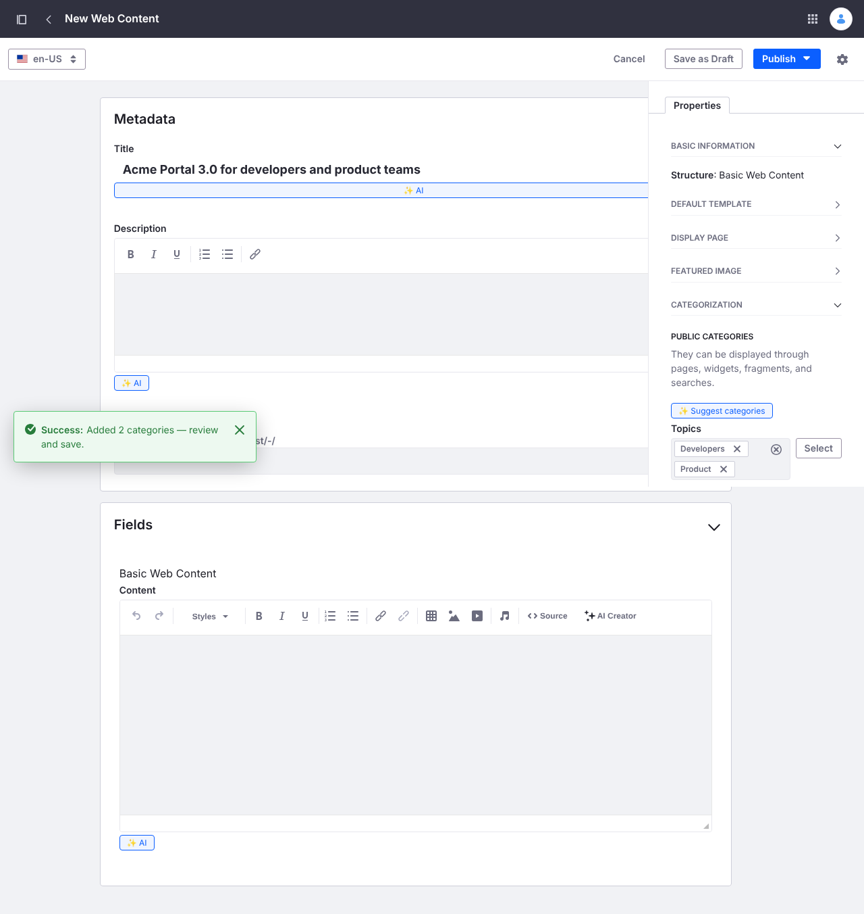

# Using the Connector
{: .no_toc }

1. TOC
{:toc}

## The chat widget

Once [AI Hub Chat is on](configuration.html#turn-on-ai-hub-chat), AI Hub's chat widget appears at the bottom of every page, for signed-in users (and for guests if **Guest Users Allowed** is on and the chatbot allows guests). It behaves exactly as it does on 2026.Q1+ with Liferay's own cell:

- The chat answers **as the signed-in user** — the connector sends a per-user token, which AI Hub forwards back to the DXP, so reads follow that user's permissions.
- With the MCP server connected, the chatbot's agent can use its tools; writes come back as **approval links** the user confirms while signed in.
- Turn it off for a single site in that site's **Site Settings → AI Hub**, or point a site at a different chatbot.

## The in-editor AI Assistant

With [AI Hub Assistant on](configuration.html#turn-on-the-in-editor-ai-assistant), an **✨ AI** action appears beside Web Content fields in the editor. Each action runs an AI Hub agent for the signed-in user and writes the result back. These are AI Hub's own agents — the connector defines none.

{: .screenshot }

### Writing tools

On the Title and on rich-text bodies, the **✨ AI** menu offers:

| Action | What it does |
|---|---|
| **Improve writing** | Rewrites the selected field more clearly. |
| **Fix spelling &amp; grammar** | Corrects the text. |
| **Make shorter** / **Make longer** | Condenses or expands it. |
| **Change tone** | Rewrites in a tone you choose (e.g. Professional, Casual). |

### Suggest tags

On the Categorization panel, **✨ Suggest tags** reads the article, fetches the site's existing tags, asks AI Hub for relevant tags, and applies them to the tags picker.

### Suggest categories

**✨ Suggest categories** matches the article against the site's vocabularies and applies the categories that fit — the ids land in the form's hidden fields and persist on save.

{: .screenshot }

### Generate a field value

**✨ Generate** takes an instruction ("a title based on the content"), runs the field-generation agent, and writes the returned value into the named field.

### Generate an image

**✨ Generate image** on a rich-text body takes a description, generates an image through AI Hub's agent event stream, uploads it to **Documents &amp; Media**, and inserts it inline into the body.

### Translate

**✨ Translate** lets you pick the site's other languages and translates the article's localizable fields — Title, Description and rich-text body — into each, leaving the default language untouched.

{: .note }
**Authors need the right permissions.** Every assistant action runs in the browser **as the signed-in user**, so it's gated by that user's own permissions — not by the connector's token scopes. Writing tools, Generate and Translate work for any author. **Suggest categories** needs *View* on the site's categories, and **Generate image** needs *Add Document* on Documents &amp; Media. See [Reference → Author permissions](reference.html#author-permissions).

## Workflow agent step

With [Workflow Agent Step on](configuration.html#optional-the-workflow-agent-step), a Kaleo workflow can run an AI Hub agent as a step — standing in for the AI Hub agent node that only 2026.Q1+ has.

- Add a `<task>` assigned to the `aihub-connector` user with an `onAssignment` action whose **script language is `function#aihub-legacy-agent`** and whose script is the step's settings as JSON: `agentDefinitionExternalReferenceCode` (required), `timeout` in ms (default 120000, max 900000), `transition` and `errorTransition` (optional).
- When the workflow transaction commits, the connector calls AI Hub's agent synchronously on the server, as **the user who started the workflow**, puts the agent's response fields (including `output`) into the workflow context, and completes the task so the workflow moves on.
- On failure, the task takes `errorTransition` (with `aiHubAgentError` in the context); without one it waits with `aihub-connector` for an administrator.

{: .warning }
Use the `function#aihub-legacy-agent` script language, **not** `java`. From 2024.Q3, Kaleo refuses `java` and Groovy workflow actions unless Script Management is allowed to run script content — which should stay off.

See the sample workflow shipped with the connector (`examples/ai-hub-agent-step.workflow.xml`).

## Upgrading to 2026.Q1 or later

When you move to a DXP that has Liferay's own AI Hub cell, turn the connector's features off and uninstall it (see [Installing → Upgrade and remove](installing.html#upgrade-and-remove)); AI Hub's native chat, in-editor assistant and agent node take over. Replace the workflow task and its action with Liferay's `<ai-hub-agent>` node.
