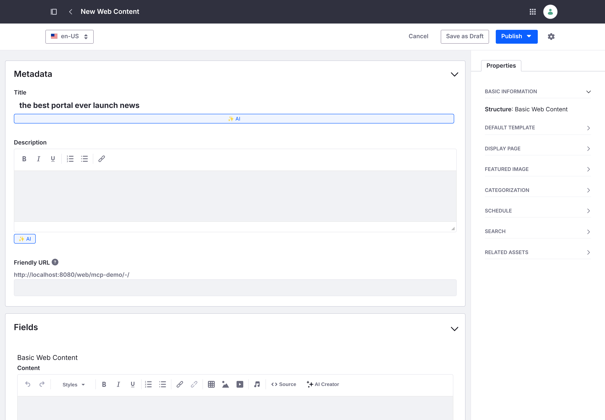
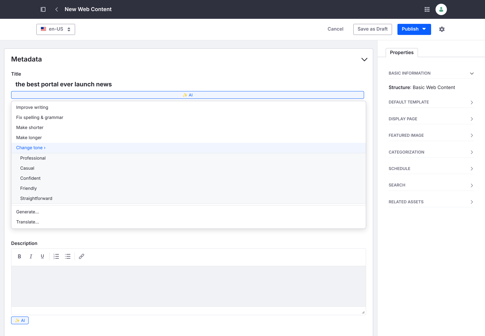
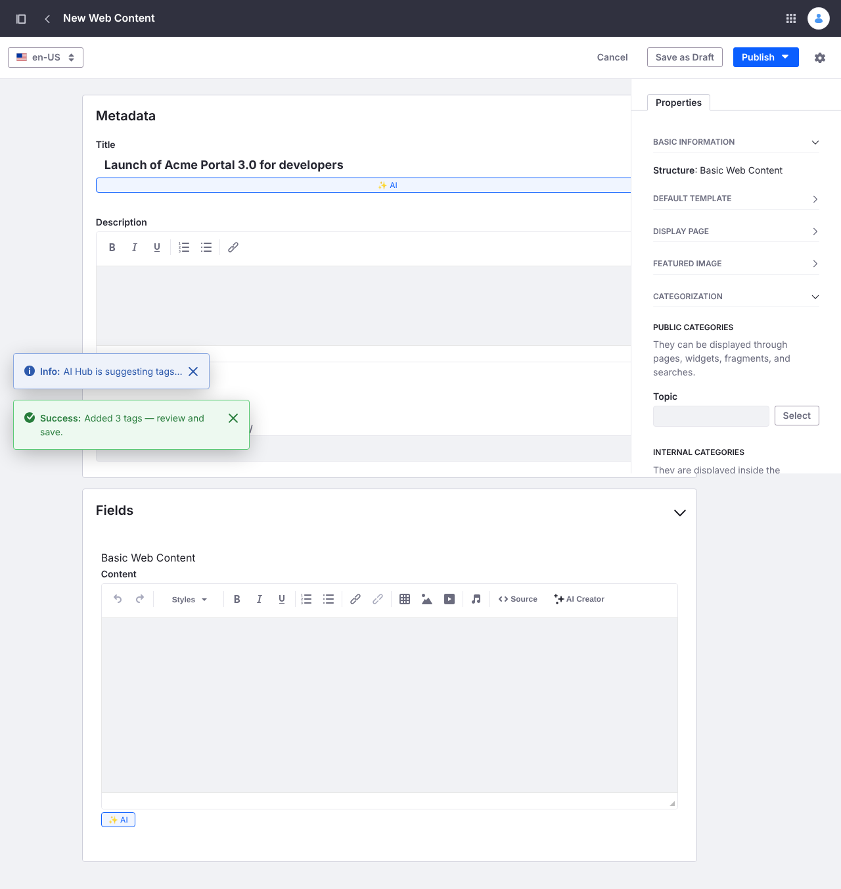
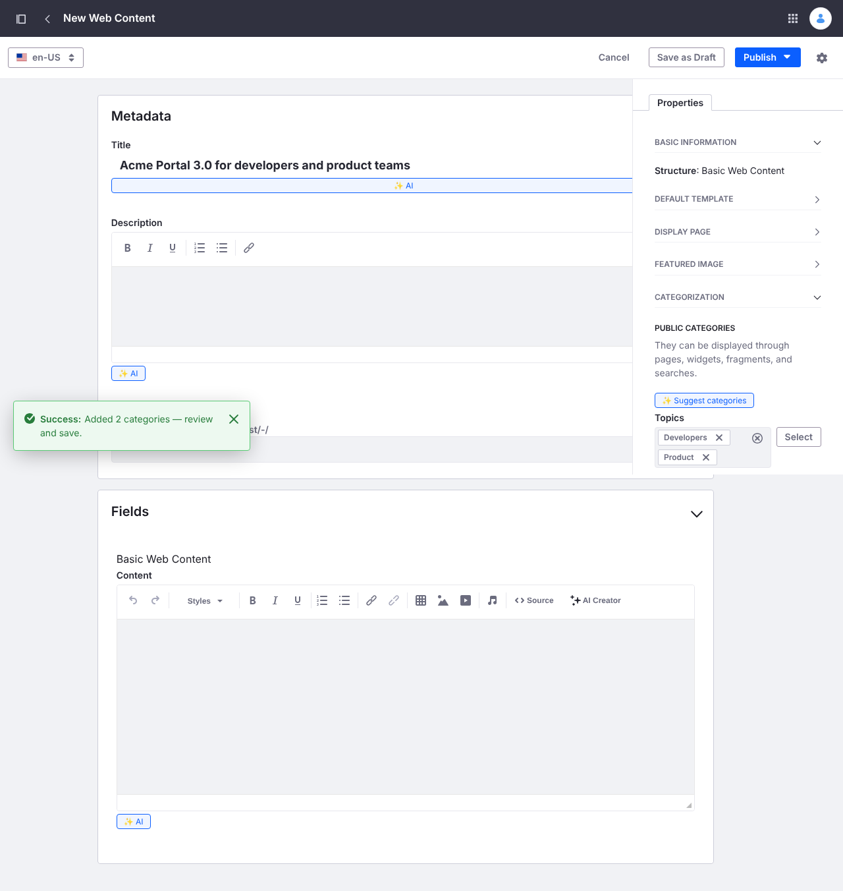
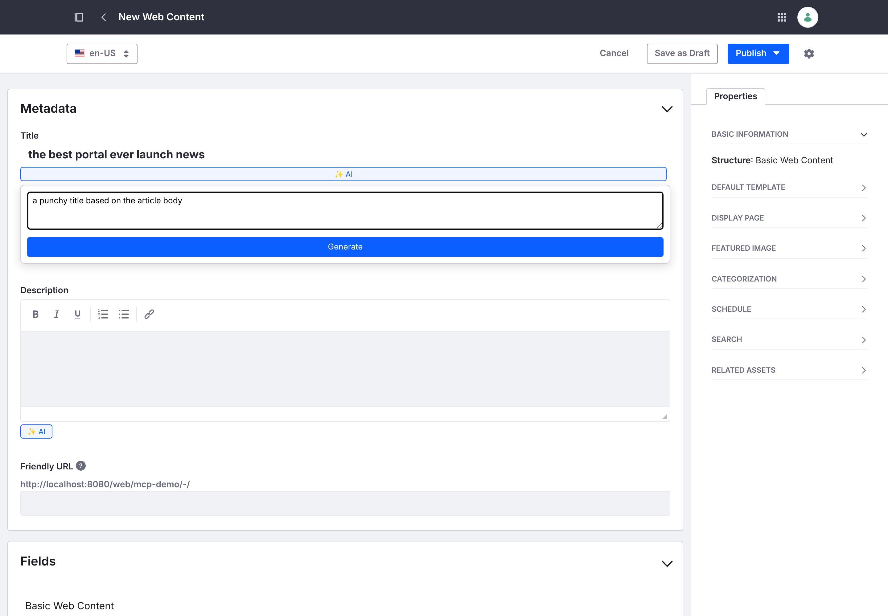
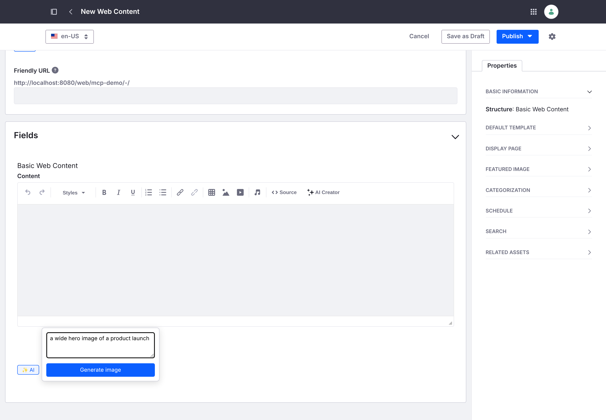

# In-editor AI Assistant
{: .no_toc }

1. TOC
{:toc}

With **AI Hub Assistant** on, an **✨ AI** action appears beside Web Content fields in the editor. Each action runs an AI Hub agent for the signed-in user and writes the result back. These are AI Hub's own agents — the connector defines none.

{: .screenshot }

## Turn it on

**Instance Settings → AI Hub → AI Hub Tokens → AI Hub Assistant** (off by default). While off, no trigger is added. The assistant turns token issuing on by itself, so it works with AI Hub Tokens configured even if AI Hub **Chat** is off.

{: .note }
Every assistant action runs in the browser **as the signed-in user**, so it is gated by that user's own permissions — not by the connector's token scopes. See [Author Permissions](permissions.html) for what a non-admin author needs.

## Writing tools

On the Title and on rich-text bodies, the **✨ AI** menu offers the writing tools. **Change tone** opens a submenu of tones.

{: .screenshot }

| Action | Agent | What it does |
|---|---|---|
| Improve writing | `L_IMPROVE_WRITING` | Rewrites the field more clearly. |
| Fix spelling &amp; grammar | `L_FIX_SPELLING_AND_GRAMMAR` | Corrects the text. |
| Make shorter / longer | `L_MAKE_SHORTER` / `L_MAKE_LONGER` | Condenses or expands it. |
| Change tone | `L_CHANGE_TONE` | Rewrites in the tone you pick. |

## Suggest tags and categories

On the Categorization panel, **✨ Suggest tags** reads the article, fetches the site's existing tags, asks AI Hub (`L_GENERATE_TAGS`), and applies the suggestions to the tags picker.

{: .screenshot }

**✨ Suggest categories** (`L_AUTO_CATEGORIZE`) matches the article against the site's vocabularies and applies the categories that fit — the ids land in the form's hidden fields and persist on save.

{: .screenshot }

## Generate a field value

**✨ Generate** takes an instruction, runs `L_GENERATE_FIELD_VALUE`, and writes the returned value into the named field (Title input or CKEditor).

{: .screenshot }

## Generate an image

**✨ Generate image** on a rich-text body takes a description, generates an image through AI Hub's agent event stream (`L_GENERATE_IMAGE`), uploads it to **Documents &amp; Media**, and inserts it inline into the body.

{: .screenshot }

## The proxy

With the proxy on (the default), the browser never gets AI Hub's access token. The assistant fetches tokens (`POST /o/ai-hub-cell/v1.0/authorization-tokens`), then calls `agent-instances` through this Liferay's proxy at `/o/ai-hub-cell-proxy`, which adds AI Hub's access token on the server and forwards the call with the on-behalf-of user token. The proxy passes the `agent-instances` family only. See [Security](security.html).

## Upgrading to 2026.Q1 or later

Turn the assistant off and uninstall the connector; AI Hub's own in-editor assistant takes over.
