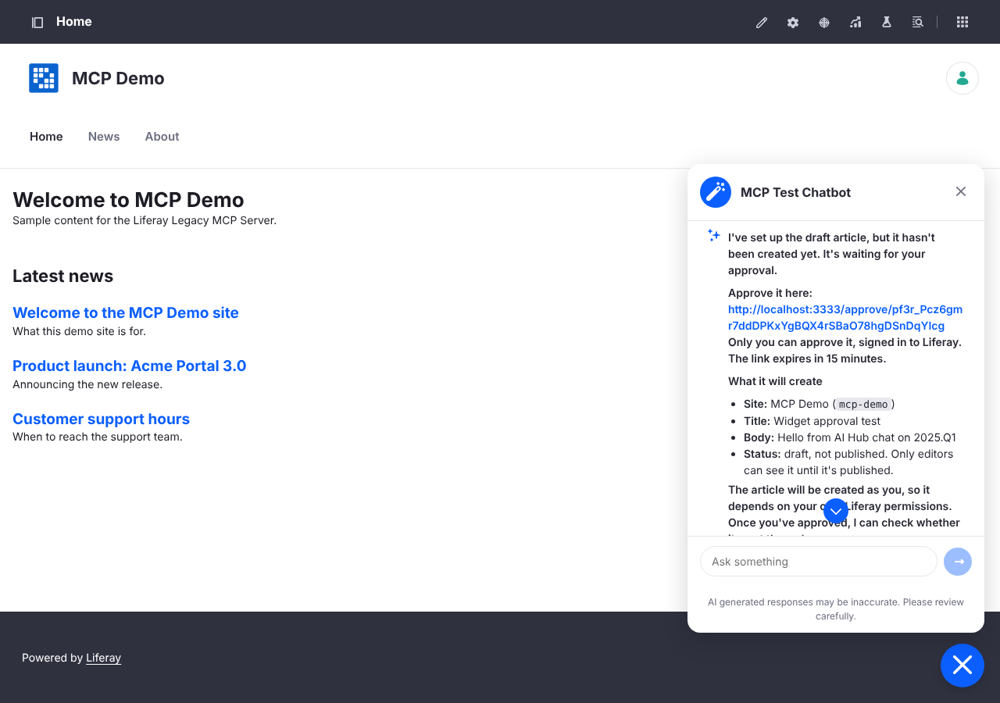
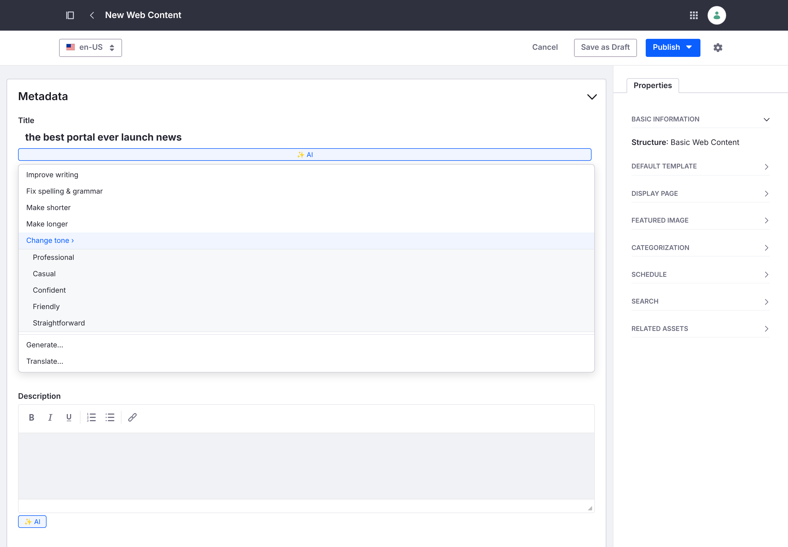

# AI Hub Legacy Connector
{: .no_toc }

An OSGi module for **Liferay DXP 2024.Q1 to 2025.Q4** that brings Liferay AI Hub to releases that shipped before the AI Hub cell. It puts AI Hub's chat widget on every page and adds AI Hub's in-editor AI Assistant to the Web Content editor — writing tools, tag and category suggestions, field and image generation, and translation — with a per-user token and a server-side proxy, and without changing Liferay's code. It steps aside automatically on releases that have Liferay's own AI Hub cell (2026.Q1 and later).

{: .screenshot }

{: .screenshot }

## Documentation

  <a class="card doc" href="getting-started.html"><strong>Getting Started</strong>What it does, how the pieces fit, and what you need.</a>
  <a class="card doc" href="installing.html"><strong>Installing</strong>The connector user, OAuth client extensions, and the module — Docker or by hand.</a>
  <a class="card doc" href="configuration.html"><strong>Configuration</strong>Connect AI Hub, the secret file, and multi-instance servers.</a>
  <a class="card doc" href="chat.html"><strong>Chat Widget</strong>Turn on AI Hub Chat and how it behaves.</a>
  <a class="card doc" href="in-editor-assistant.html"><strong>In-editor Assistant</strong>Writing tools, tags, categories, generate, image — with the proxy.</a>
  <a class="card doc" href="translate.html"><strong>Translate</strong>Translate localizable fields into the site's languages.</a>
  <a class="card doc" href="workflow-agent-step.html"><strong>Workflow Agent Step</strong>Run an AI Hub agent as a Kaleo workflow step.</a>
  <a class="card doc" href="liferay-search.html"><strong>Liferay Search</strong>AI Hub's RAG search node across the eight releases.</a>
  <a class="card doc" href="compatibility.html"><strong>Compatibility</strong>The eight supported releases and platforms.</a>
  <a class="card doc" href="settings.html"><strong>Settings Reference</strong>Every setting and environment variable.</a>
  <a class="card doc" href="permissions.html"><strong>Author Permissions</strong>What a non-admin author needs for each action.</a>
  <a class="card doc" href="security.html"><strong>Security</strong>How the connector keeps tokens and secrets safe.</a>
  <a class="card doc" href="feature-gaps.html"><strong>Feature Gaps</strong>What stays with AI Hub, and why.</a>

## What it brings

- **AI Hub Chat** — AI Hub's chat widget on every page, configured in Instance and Site Settings, exactly as the 2026.Q1+ cell and Click to Chat's AI Hub provider do it.
- **In-editor AI Assistant** — writing tools (improve, fix spelling &amp; grammar, make shorter/longer, change tone), suggest tags and categories, generate a field value or an image, and translate content into the site's other languages, inside the Web Content editor.
- **Per-user tokens** — the connector mints a token for the signed-in user so the chat and assistant act as that user, the way Liferay's cell does.
- **Server-side proxy** — on by default, so AI Hub's access token stays on the server and browsers only ever call their own Liferay.
- **AI Hub's Liferay Search** on 2024.Q1 and 2024.Q2, which lack the endpoint it calls.
- **Workflow agent step** — run an AI Hub agent as a workflow step through Kaleo, standing in for the 2026.Q1+ AI Hub agent node.

## Install

The connector is distributed as an installer image on GitHub Container Registry — [the `liferay-aihub-legacy-connector` package](https://github.com/orgs/Liferay-Community-APAC/packages/container/package/liferay-aihub-legacy-connector) — which writes the module and its client extensions into a Liferay deploy folder. See [Installing](installing.html), then [Configuration](configuration.html).

{: .important }
**A licensed Liferay AI Hub is required.** The connector reproduces, on earlier releases, the part of AI Hub that runs on the customer's DXP (the "cell") — it mints the user token and hosts the front end, then calls your AI Hub instance for every chat message and assistant action. It is not a model provider and does nothing without an AI Hub subscription. It is a Liferay Community APAC app for Liferay internal use; Liferay does not support it.
