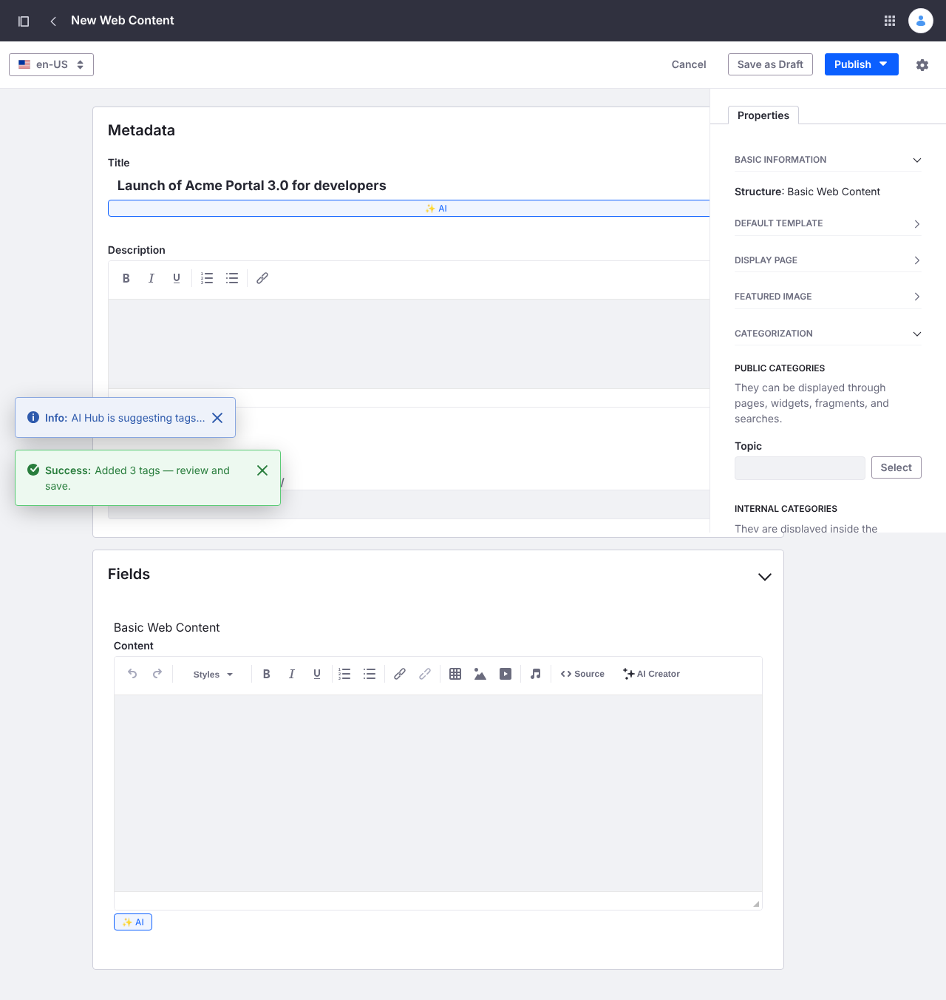

# AI Hub Legacy Connector
{: .no_toc }

An OSGi module for **Liferay DXP 2024.Q1 to 2025.Q4** that brings Liferay AI Hub to releases that shipped before the AI Hub cell. It puts AI Hub's chat widget on every page and adds AI Hub's in-editor AI Assistant to the Web Content editor — writing tools, tag and category suggestions, field and image generation, and translation — with a per-user token and a server-side proxy, and without changing Liferay's code. It steps aside automatically once you upgrade to a release that has Liferay's own AI Hub cell (2026.Q1 and later).

{: .screenshot }

{: .warning }
**Coming soon.** AI Hub Legacy Connector isn't available yet. It's in release-candidate testing across all eight target releases (DXP 2024.Q1 to 2025.Q4). It brings a **licensed** Liferay AI Hub to releases that predate the AI Hub cell — it isn't a Liferay product, Liferay doesn't support it, and it doesn't replace an AI Hub subscription. The screenshots on this page are from a development build and will be refreshed against the shipped release. Want early access or a walkthrough? Reach out to the Liferay Community APAC team.

1. TOC
{:toc}

## Highlights

- **AI Hub chat on every page.** The AI Hub chat widget, configured in Instance and Site Settings the way the 2026.Q1+ cell provides it, on every page, without changing Liferay's code.
- **In-editor AI Assistant.** Writing tools (improve, fix spelling and grammar, make shorter or longer, change tone), suggest tags and categories, generate a field value or an image, and translate content into the site's other languages — right inside the Web Content editor.
- **Secure by default.** A per-user token so the chat acts as the signed-in user, and a server-side proxy that keeps AI Hub's access token out of the browser: browsers only ever call their own Liferay.
- **Steps aside on upgrade.** Deactivates itself automatically where Liferay's own AI Hub cell or the Click to Chat AI Hub provider is present, so moving to 2026.Q1 or later needs no cleanup.
- **Across eight releases.** Validated on DXP 2024.Q1, Q2, Q3, Q4 and 2025.Q1, Q2, Q3, Q4, each on the latest update of the quarter.
- **Uses your AI Hub subscription.** The connector reuses your licensed Liferay AI Hub; it isn't a model provider and doesn't replace an AI Hub subscription.

## See It in Action

The assistant adds an **✨ AI** action beside Web Content fields. "Suggest categories" reads the article, matches it against the site's vocabularies, and applies the categories that fit — the ids land in the form's hidden fields and persist on save:

{: .screenshot }

## Supported Versions

| AI Hub Legacy Connector | Liferay DXP |
| --- | --- |
| 2.8.3 | 2024.Q1 to 2025.Q4, tested on the latest update of each quarter. |

{: .important }
**A licensed Liferay AI Hub is required.** The connector reproduces, on earlier releases, the part of AI Hub that runs on the customer's DXP (the "cell"): it mints a token for the signed-in user and hosts the front end, then calls your AI Hub instance for every chat message and assistant action. It is not a model provider and does nothing without an AI Hub subscription.

## How It's Delivered

The connector is one OSGi bundle (`com.lgsapac.aihub.legacy.token`) plus two OAuth client extensions, installed from a container image on GitHub Container Registry that writes them into a Liferay deploy folder. Installation and configuration steps will be published here when the app is released.
