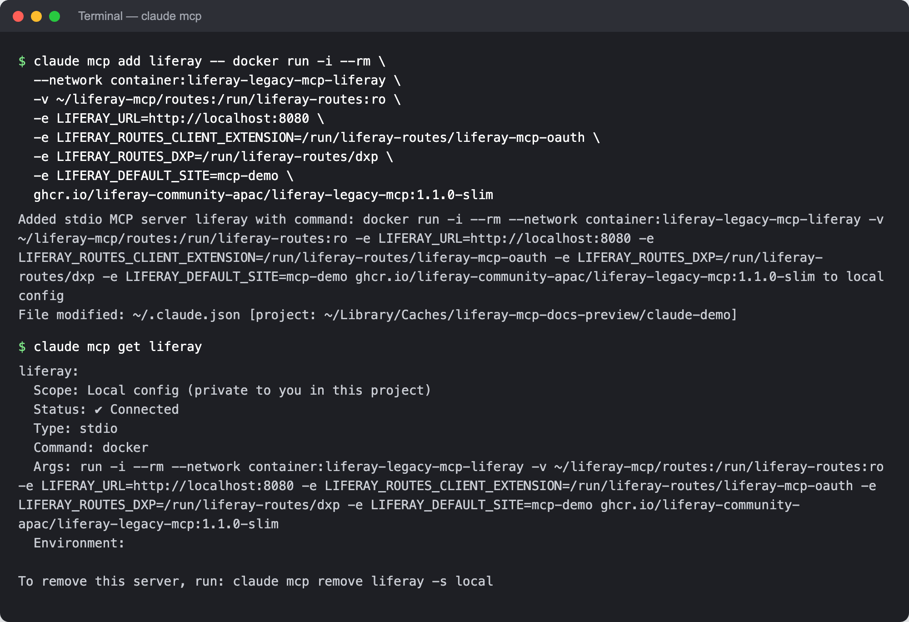
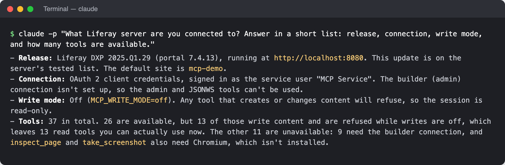
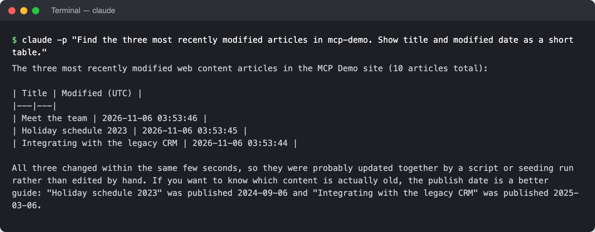

# With Claude Code
{: .no_toc }

[Claude Code](https://claude.com/claude-code) adds MCP servers with one command, `claude mcp add`, and starts them itself, so each person runs their own copy of the server, as in [For One Person](stdio.html).

{: .important }
You need Docker, Claude Code, and a copy of the [routes folder](liferay-setup.html#step-3-save-the-credentials-for-the-server) on your computer, readable only by you.

1. TOC
{:toc}

## Step 1: Add the Server

Run this once, with your Liferay's address, your routes folder, and the site to work in by default:

```bash
claude mcp add liferay -- docker run -i --rm \
  -v ~/liferay-mcp/routes:/run/liferay-routes:ro \
  -v liferay-mcp-data:/data \
  -e LIFERAY_URL=https://liferay.example.com \
  -e LIFERAY_ROUTES_CLIENT_EXTENSION=/run/liferay-routes/liferay-mcp-oauth \
  -e LIFERAY_ROUTES_DXP=/run/liferay-routes/dxp \
  -e LIFERAY_DEFAULT_SITE=my-site \
  ghcr.io/liferay-community-apac/liferay-legacy-mcp:1.1.0-slim
```

Everything after `--` is the command Claude Code runs to start the server. If you wrote the routes folder by hand, it has no `dxp` folder: leave out the `LIFERAY_ROUTES_DXP` line.

By default, the server is added for the current folder only, and only for you. Add `-s user` after `add` to use it in every folder, or `-s project` to share it with your team in the folder's `.mcp.json`; teammates then approve it the first time they start Claude Code there, and need their own routes folder.

## Step 2: Check That It Connects

```bash
claude mcp get liferay
```

It shows **Status: ✔ Connected** once Claude Code could start the server and list its tools. In a Claude Code session, `/mcp` shows the same.

{: .screenshot }

{: .note }
These screenshots were taken against a test Liferay in a local Docker container named `liferay-legacy-mcp-liferay`, so the server joins that container's network (`--network container:…`) and reaches Liferay at `http://localhost:8080`. Against your own Liferay, use its address, as in Step 1.

## Step 3: Ask

Start Claude Code with `claude`, and ask *"What Liferay server are you connected to?"* Claude Code asks you to allow each Liferay tool the first time it uses it. The answer names your Liferay's release, the connection, the write mode, and how many tools your Liferay supports:

{: .screenshot }

Then ask about your content:

{: .screenshot }

These were asked with `claude -p`, which runs one question and prints the answer; the same questions work in an interactive session.

## Step 4: Turn On Writes (Optional)

Writes are off until you add `-e MCP_WRITE_MODE=confirm` before the image name. Remove the server and add it again with that line:

```bash
claude mcp remove liferay
```

Each write is then shown as a preview in Claude Code, and runs only once you confirm it. See [Writes and Previews](../using/writes.html).

## Related Information

- [What to Ask](../using/what-to-ask.html)
- [For One Person](stdio.html)
- [Checking the Installation](checking.html)
