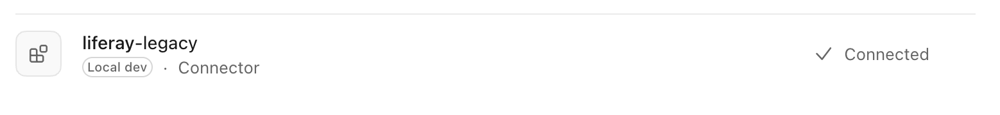
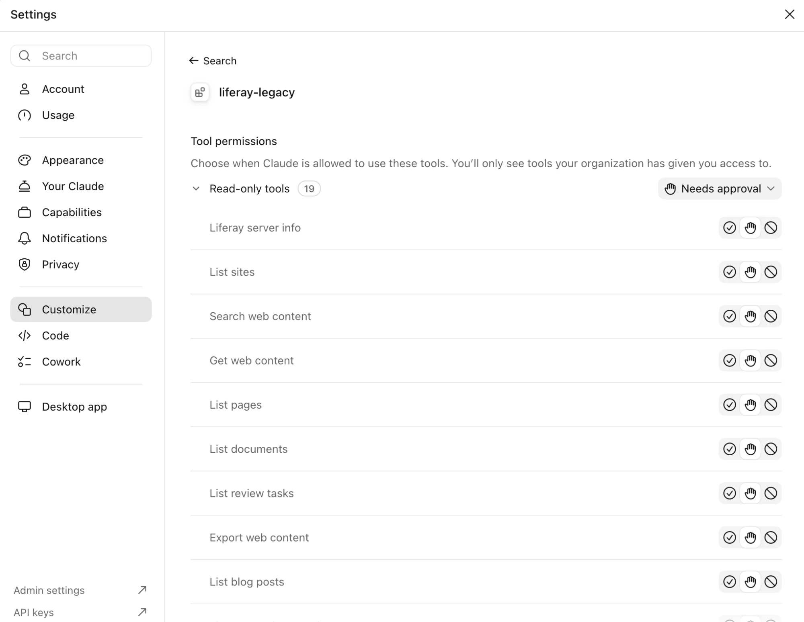

# With the Claude Desktop App
{: .no_toc }

The Claude desktop app starts the server on your computer, for its chats and for its **Code** tab. The two are set up in different places: the chat reads the app's own configuration file, and the Code tab uses Claude Code's servers.

{: .important }
You need Docker, the Claude desktop app, and a copy of the server's credentials on your computer, as in the page for where your Liferay runs ([Tomcat](tomcat.html), [Docker](docker.html), [PaaS](paas.html)), readable only by you.

1. TOC
{:toc}

## In Chats

### Step 1: Add the Server to the App's Configuration

1. Quit the Claude desktop app (**Cmd+Q** on macOS). While it runs, it can overwrite the file you're about to edit.
1. Open the app's configuration file, `claude_desktop_config.json`: on macOS in `~/Library/Application Support/Claude/`, on Windows in `%APPDATA%\Claude\`. Create it if it doesn't exist.
1. Add the server under `mcpServers`, next to what's already in the file:

    ```json
    {
      "mcpServers": {
        "liferay-legacy": {
          "command": "/usr/local/bin/docker",
          "args": [
            "run", "-i", "--rm",
            "-v", "/Users/me/liferay-mcp/routes:/run/liferay-routes:ro",
            "-v", "liferay-mcp-data:/data",
            "-e", "LIFERAY_URL=https://liferay.example.com",
            "-e", "LIFERAY_ROUTES_CLIENT_EXTENSION=/run/liferay-routes/liferay-mcp-oauth",
            "-e", "LIFERAY_DEFAULT_SITE=my-site",
            "ghcr.io/liferay-community-apac/liferay-legacy-mcp:1.1.0-slim"
          ]
        }
      }
    }
    ```

    - **`command`:** Docker's full path, from `which docker` in a terminal, such as `/usr/local/bin/docker`, or `/opt/homebrew/bin/docker` with Homebrew. The app doesn't search the same folders as your terminal.
    - **The routes folder:** its full path, without `~`, to the folder that holds the `liferay-mcp-oauth` folder.
    - Keep the rest of the file as it is: it's valid JSON only with every comma and bracket in place.
1. Start the app again.

### Step 2: Check That It Connects

Open *Settings* → *Customize*. The server is listed as a **Local dev** connector, **Connected**:

{: .screenshot }

Click it to see its tools, and choose when Claude may use them. By default, each one **Needs approval**: Claude asks you before it uses it.

{: .screenshot }

{: .tip }
To be asked less often, set the **Read-only tools** to always allowed, and keep the others on **Needs approval**. Writes are off until you turn them on in the server, and then every write still shows a preview first. See [Writes and Previews](../using/writes.html).

### Step 3: Ask

In a new chat, ask *"What Liferay server are you connected to?"*, and allow the tool. The answer names your Liferay's release, the connection, the write mode, and how many tools your Liferay supports. Then try the questions in [What to Ask](../using/what-to-ask.html).

## In the Code Tab

The **Code** tab runs Claude Code, and uses the same servers as Claude Code in a terminal: the app's configuration file and its connectors settings don't apply there. Add the server with the [Claude Code command line tool](https://code.claude.com/docs/en/quickstart), with `-s user` so it's available in every folder you open:

```bash
claude mcp add -s user liferay-legacy -- docker run -i --rm \
  -v ~/liferay-mcp/routes:/run/liferay-routes:ro \
  -v liferay-mcp-data:/data \
  -e LIFERAY_URL=https://liferay.example.com \
  -e LIFERAY_ROUTES_CLIENT_EXTENSION=/run/liferay-routes/liferay-mcp-oauth \
  -e LIFERAY_DEFAULT_SITE=my-site \
  ghcr.io/liferay-community-apac/liferay-legacy-mcp:1.1.0-slim
```

Then start a new Code session, and type `/mcp`: it lists **liferay-legacy** once the app could start it. Sessions that were already open don't pick it up.

To connect more than one Liferay, add one server for each, in both places, named after it, such as `liferay-legacy-prod` and `liferay-legacy-test`.

## Related Information

- [With Claude Code](claude-code.html)
- [Writes and Previews](../using/writes.html)
- [Checking the Installation](checking.html)
