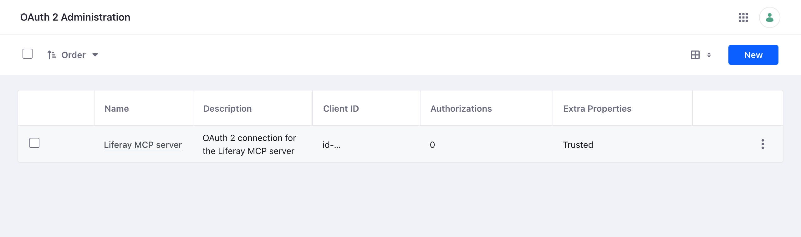

# Installing on Liferay Self-Hosted (Docker)
{: .no_toc }

Liferay runs in a container, and the server runs in a second container that shares Liferay's network, so it reaches Liferay at `localhost:8080` as on a server. You copy the OAuth 2 client extension into the running Liferay container.

{: .important }
You need Docker, the [service user](liferay-setup.html), and Liferay must be running. The commands use `liferay` as the name of Liferay's container; use yours.

1. TOC
{:toc}

## Step 1: Give Liferay a Routes Volume

Liferay writes the server's credentials to `/opt/liferay/routes` in its container. Start Liferay with a volume there, so the server's container can read them, and with the server's port published, if people or services will reach the server over HTTPS:

```bash
docker run -d --name liferay -p 8080:8080 -p 127.0.0.1:3333:3333 --restart unless-stopped \
  -v liferay-data:/opt/liferay/data \
  -v liferay-routes:/opt/liferay/routes \
  liferay/dxp:2025.q1.29-lts
```

Add your own settings, such as the database, as usual. If your Liferay container already runs without these, start a new one with them, keeping its data volume.

## Step 2: Deploy the OAuth 2 Client Extension

1. Download [`liferay-mcp-oauth.zip`](../assets/downloads/liferay-mcp-oauth.zip), or, to keep the server read-only, [`liferay-mcp-oauth-read-only.zip`](../assets/downloads/liferay-mcp-oauth-read-only.zip) (see [Changing the Client Extension](liferay-setup.html#changing-the-client-extension)), and copy it into the running container. For the read-only one, use its name in the command:

    ```bash
    docker cp liferay-mcp-oauth.zip liferay:/opt/liferay/osgi/client-extensions/
    ```

1. Wait until `docker logs liferay` shows `STARTED liferay-mcp-oauth`, then check that the credentials are there:

    ```bash
    docker exec liferay ls /opt/liferay/routes/default/liferay-mcp-oauth
    ```

Liferay creates an OAuth 2 application named **Liferay MCP server**, shown in *Control Panel* → *Security* → *OAuth 2 Administration*, which acts as the service user:

{: .screenshot }

## Step 3: Run the Server

The server's container joins Liferay's network (`--network container:liferay`), and reads the routes from Liferay's volume. Both run as user ID 1000, so no copy is needed.

- **Shared, over HTTPS:**

    ```bash
    docker run -d --name liferay-mcp --restart unless-stopped --network container:liferay \
      -v liferay-routes:/opt/liferay/routes:ro \
      -v /srv/liferay-mcp/secrets:/run/mcp-secrets:ro \
      -v liferay-mcp-data:/data \
      -e LIFERAY_URL=http://localhost:8080 \
      -e LIFERAY_ROUTES_CLIENT_EXTENSION=/opt/liferay/routes/default/liferay-mcp-oauth \
      -e MCP_HTTP_HOST=0.0.0.0 \
      -e MCP_PUBLIC_URL=https://mcp.example.com \
      -e MCP_TRUST_PROXY=private \
      -e MCP_HTTP_API_KEYS_FILE=/run/mcp-secrets/api-keys \
      ghcr.io/liferay-community-apac/liferay-legacy-mcp:1.1.0-slim --http
    ```

    Create `/srv/liferay-mcp/secrets/api-keys` first, as in [Give Services API Keys](http.html#step-2-give-services-api-keys). The server is reachable at `127.0.0.1:3333` on the Docker host, through the port Liferay's container publishes. Put your HTTPS reverse proxy for `https://mcp.example.com` in front of it, and follow [For Services and People](http.html) for API keys and sign-in.

- **For a person on the Docker host,** with Claude Code: the same container, started by Claude Code, as in [With Claude Code](claude-code.html):

    ```bash
    claude mcp add liferay-legacy -- docker run -i --rm --network container:liferay \
      -v liferay-routes:/opt/liferay/routes:ro \
      -e LIFERAY_URL=http://localhost:8080 \
      -e LIFERAY_ROUTES_CLIENT_EXTENSION=/opt/liferay/routes/default/liferay-mcp-oauth \
      -e LIFERAY_DEFAULT_SITE=my-site \
      ghcr.io/liferay-community-apac/liferay-legacy-mcp:1.1.0-slim
    ```

- **On another computer:** copy the credentials out with `docker cp liferay:/opt/liferay/routes/default/liferay-mcp-oauth .`, give them to the person securely, and set `LIFERAY_URL` to your Liferay's address.

{: .note }
Checked on Liferay DXP 2025.Q1.29 in Docker: the zip created the application and its credentials within seconds, and the server, in a container sharing Liferay's network, connected with OAuth 2 and all nine scopes, both started by Claude Code and as the shared HTTPS server. Reached at the Liferay container's network address, as a published port is, the HTTPS server refused a request without a key or with a wrong one (401), and answered one with a key made as in [For Services and People](http.html#step-2-give-services-api-keys).

## Day to Day

- **After Liferay's container restarts,** restart the server's container too, since it shares Liferay's network: `docker restart liferay-mcp`.
- **If you replace Liferay's container,** the client extension zip goes with it: copy it in again as in Step 2. The routes volume keeps the credentials, and deploying the zip again keeps the same ones. Restart the server afterwards, since it shares Liferay's network.

## Related Information

- [Checking the Installation](checking.html)
- [Upgrading and Removing](upgrading-and-removing.html)
