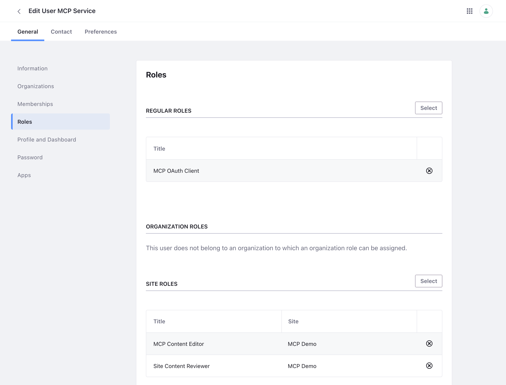

# Creating the Service User
{: .no_toc }

The server acts as one Liferay user, with least privilege. Create it once per Liferay, as an administrator, before you follow the page for where your Liferay runs.

1. TOC
{:toc}

## Step 1: Turn Off Email Verification for New Users

If it's on: *Control Panel* → *Instance Settings* → *User Authentication* → clear **Require strangers to verify their email address?**, and click **Save**. Otherwise the new user can wait on the *Verify Email Address* page, and every API call as it fails with 403.

## Step 2: Create the User

Create a user with the screen name **`mcp-service`**, for example with the email `mcp-service@example.com`. The [OAuth 2 client extension](../assets/downloads/liferay-mcp-oauth.zip) acts as the user with that screen name; to use another one, see [Changing the Client Extension](#changing-the-client-extension).

Give it a password nobody uses, since OAuth doesn't need one, and make sure it isn't required to change it at its first sign-in (the password policy's **Change Required**), or every API call as it fails with 403.

## Step 3: Create Its Roles

1. **A site role,** for example **MCP Content Editor**, in *Control Panel* → *Users* → *Roles*, with these permissions. It lets the user view content, and add and edit what the write tools write, but not delete or change permissions:

    | Resource | Actions |
    | --- | --- |
    | Web Content | Add Article, Add Folder, View |
    | Web Content Article | Update, View |
    | Web Content Folder | Add Article, Add Subfolder, View |
    | Documents and Media | Add Document, View |
    | Document | Update, View |
    | Documents Folder | View |
    | Page | View |
    | Blogs / Blogs Entry | Add Entry / Update, View |
    | Categories / Category / Vocabulary | Add Category, Add Vocabulary / Add Category, Update, View / View |
    | Navigation Menus / Navigation Menu | Add Navigation Menu / Update, View |
    | Knowledge Base / Article / Folder | Add Article, Add Folder / Update, View / Add Article, View |
    | Wiki / Wiki Node / Wiki Page | Add Node / Add Page, View / Update, View |
    | Message Boards / Category / Message | Add Message, Reply to Message / Add Message, View / Update, View |
    | Form | View |

    Leave out the areas you don't want the AI assistant to write.
1. **A regular role,** for example **MCP OAuth Client**, with *Control Panel* → *Security* → *OAuth 2 Administration* → **OAuth 2 Application: Create Token**. Liferay only issues a token that acts as a user who has it.

## Step 4: Assign Them

1. Assign the regular role to the user.
1. Make the user a member of each site the server should work in, and give it the site role there. If it should review content in a workflow, also give it **Site Content Reviewer** in those sites.

The user's *Roles* page then shows the regular role, and the site roles in each site:

{: .screenshot }

{: .tip }
For signed-in page inspection, also create a second, view-only user that is only a site member, with no roles. Without it, the page inspection tools view pages as a guest.

## Changing the Client Extension

There are two ready-made zips. Both act as `mcp-service`:

| Download | Scopes | Made From |
| --- | --- | --- |
| [`liferay-mcp-oauth.zip`](../assets/downloads/liferay-mcp-oauth.zip) | Allow writes. The server still writes nothing until you turn writes on with `MCP_WRITE_MODE=confirm`, and then only after each change is confirmed. | [`liferay-mcp-oauth.client-extension.yaml`](../assets/downloads/liferay-mcp-oauth.client-extension.yaml) |
| [`liferay-mcp-oauth-read-only.zip`](../assets/downloads/liferay-mcp-oauth-read-only.zip) | Read-only: Liferay refuses every write, whatever the server's settings, and the server shows its write tools as unavailable. | [`liferay-mcp-oauth-read-only.client-extension.yaml`](../assets/downloads/liferay-mcp-oauth-read-only.client-extension.yaml) |

Deploy one of them, not both: they create the same application. To use another screen name or other scopes, edit the `client-extension.yaml` the zip is made from, and build your own zip with a Liferay Workspace:

- `userAccountScreenName`: another screen name.
- `scopes`: to make the server read-only, change all six write scopes to their `.read` versions: `Liferay.Headless.Delivery.everything`, `Liferay.Headless.Admin.Content.everything`, `Liferay.Headless.Admin.Taxonomy.everything`, `Liferay.Headless.Admin.Workflow.everything`, `Liferay.Headless.Batch.Engine.everything` and `Liferay.Headless.Form.everything`. Leaving any of them as is leaves its area writable: tags and categories, for example, with Admin Taxonomy.

Save it as `client-extension.yaml` in a folder of your workspace's `client-extensions` folder, for example `client-extensions/liferay-mcp-oauth/`, and build it from that folder:

```bash
blade gw build
```

The zip is `dist/liferay-mcp-oauth.zip` in that folder. Keep the file's `.serviceAddress` and `.serviceScheme` lines: they give the application the home page Liferay requires, and without them Liferay refuses to create it.

{: .note }
Checked on Liferay DXP 2025.Q1.29: the zip built this way created the application and its credentials, and the server connected with them. With the read-only scopes, Liferay refused a write in each of the six areas (403), reads still worked, and the server showed all 18 of its write tools as unavailable, even with `MCP_WRITE_MODE=confirm`.

## Next Steps

Continue with the page for where your Liferay runs:

<div class="doc-cards">
  <a class="card doc" href="tomcat.html"><strong>Liferay Self-Hosted (Tomcat)</strong><span>Liferay installed from a Tomcat bundle on a server you manage.</span></a>
  <a class="card doc" href="docker.html"><strong>Liferay Self-Hosted (Docker)</strong><span>Liferay running in a container.</span></a>
  <a class="card doc" href="paas.html"><strong>Liferay PaaS</strong><span>Liferay running on Liferay Cloud.</span></a>
</div>
