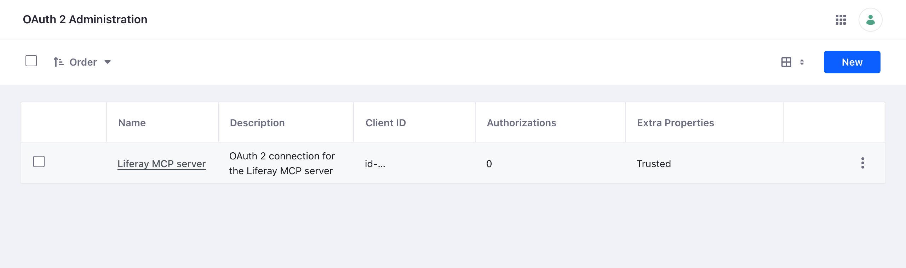

# Installing on Liferay PaaS
{: .no_toc }

On Liferay PaaS, you add the OAuth 2 client extension to your PaaS project's repository, and deploy it with the rest of the project. The server then runs outside Liferay Cloud, on each person's computer or on a server of yours, with the application's credentials copied from Liferay.

{: .warning }
These steps haven't been tested on a Liferay PaaS environment yet. Running the server as a service inside Liferay Cloud isn't covered.

1. TOC
{:toc}

## Step 1: Prepare the Project

Follow Liferay's [Configuring Liferay PaaS for Client Extensions](https://learn.liferay.com/w/dxp/cloud/customizing-liferay-dxp-in-the-cloud/configuring-liferay-paas-for-client-extensions). In particular, if your `infra` environment doesn't have the client extension build pipeline, ask Liferay Cloud Support to enable it.

## Step 2: Add the Client Extension

1. Download [`client-extension.yaml`](../assets/downloads/liferay-mcp-oauth.client-extension.yaml), and check its `userAccountScreenName` and `scopes`, as in [Changing the Client Extension](liferay-setup.html#changing-the-client-extension).
1. Save it as `liferay/client-extensions/liferay-mcp-oauth/client-extension.yaml` in your PaaS project's repository.
1. Push the project. In the Liferay Cloud console, open **Builds**, and on the new build choose **Deploy Build to...**, then your environment.

When the deploy finishes, *Control Panel* → *Security* → *OAuth 2 Administration* shows the **Liferay MCP server** application:

{: .screenshot }

## Step 3: Copy the Credentials for the Server

The server isn't in Liferay Cloud, so it can't read Liferay's routes. Write them yourself: create a folder named `liferay-mcp-oauth` with these four files, copying the values from the application's page in *OAuth 2 Administration*, where Liferay shows the client extension's **Client ID** and **Client Secret**:

| File | Content |
| --- | --- |
| `liferay-mcp-oauth-headless-server.oauth2.headless.server.client.id` | The **Client ID** |
| `liferay-mcp-oauth-headless-server.oauth2.headless.server.client.secret` | The **Client Secret** |
| `liferay-mcp-oauth-headless-server.oauth2.headless.server.scopes` | The application's scopes, separated by spaces, as in the client extension file |
| `liferay-mcp-oauth-headless-server.oauth2.token.uri` | `/o/oauth2/token` |

Copy the scopes file too: without it, the server treats the connection as read-only.

{: .warning }
The folder holds the application's client secret. Keep it readable only by the server, like any password. Liferay issues new credentials if the client extension is deployed again with changes, so copy them again then.

## Step 4: Run the Server

With `LIFERAY_URL` set to your environment's Liferay address, for example `https://webserver-myproject-prd.lfr.cloud`:

- **On each person's computer:** give each person a copy of the folder, securely, and follow [With Claude Code](claude-code.html), [With the Claude Desktop App](claude-desktop.html), or [Other AI Assistants](stdio.html).
- **Shared, over HTTPS, on a server of yours:** follow [For Services and People](http.html).

## Without a Client Extension

If you can't deploy client extensions, create the application in the Control Panel instead. In *Control Panel* → *Security* → *OAuth 2 Administration*, add an application:

| Field | Value |
| --- | --- |
| Name | `Liferay MCP server` |
| Client Profile | Headless Server |
| Allowed Authorization Types | Client Credentials only |
| Client Credentials User | The service user |

Save it, select the scopes listed in the [client extension file](../assets/downloads/liferay-mcp-oauth.client-extension.yaml) on its **Scopes** tab, and save again. Then write the routes folder as in Step 3, with its Client ID and Client Secret.

## Related Information

- [Checking the Installation](checking.html)
- [Upgrading and Removing](upgrading-and-removing.html)
