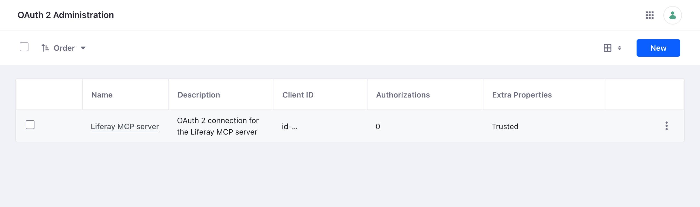
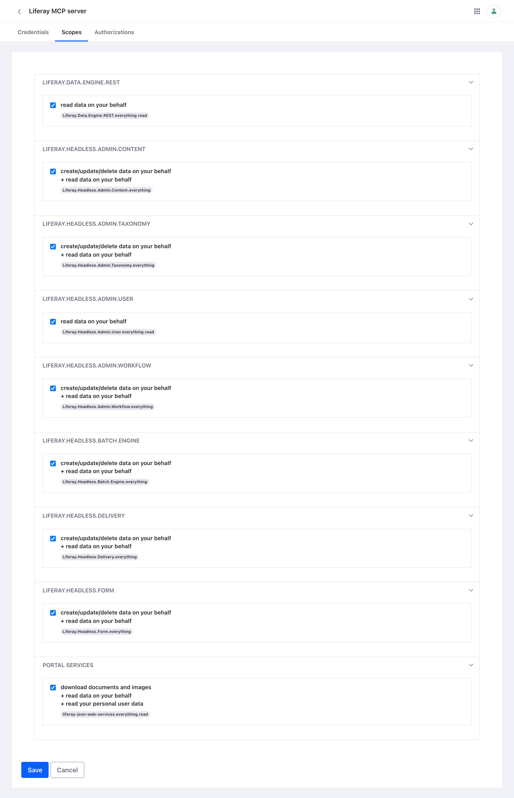

# Installing on Liferay Self-Hosted (Tomcat)
{: .no_toc }

Follow these steps when Liferay is installed from a Tomcat bundle on a server you manage. In the steps below, `<liferay-home>` is the Liferay installation folder, the one that contains the `osgi` and `routes` folders.

{: .important }
You need file access to the Liferay server, the [service user](liferay-setup.html), and Liferay must be running. To run the server on the Liferay machine, you also need Docker there.

1. TOC
{:toc}

## Step 1: Deploy the OAuth 2 Client Extension

1. Download [`liferay-mcp-oauth.zip`](../assets/downloads/liferay-mcp-oauth.zip).
1. Copy it into `<liferay-home>/osgi/client-extensions`.
1. Wait until the Liferay log shows `STARTED liferay-mcp-oauth`.

Liferay creates an OAuth 2 application named **Liferay MCP server**, which acts as the service user, and writes its credentials to `<liferay-home>/routes/default/liferay-mcp-oauth`.

{: .screenshot }

Its **Scopes** tab, in *Control Panel* → *Security* → *OAuth 2 Administration*, shows what the server may reach:

{: .screenshot }

## Step 2: Copy the Credentials for the Server

The server reads the application's credentials from a **routes folder**, one value per file. Copy Liferay's to a folder the server can read. The container runs as user ID 1000:

```bash
sudo mkdir -p /srv/liferay-mcp/routes
sudo cp -r <liferay-home>/routes/default/liferay-mcp-oauth /srv/liferay-mcp/routes/
sudo chown -R 1000:1000 /srv/liferay-mcp/routes && sudo chmod -R go-rwx /srv/liferay-mcp/routes
```

{: .warning }
The folder holds the application's client secret. Keep it readable only by the server, like any password. Copy it again if you deploy the client extension again, since Liferay then issues new credentials.

## Step 3: Run the Server

Choose how people use it:

- **Shared, over HTTPS, on the Liferay machine.** One server for services, and for people who sign in with Liferay. On Linux, it shares the machine's network, so it reaches Liferay at `http://localhost:8080`:

    ```bash
    docker run -d --name liferay-mcp --restart unless-stopped --network host \
      -v /srv/liferay-mcp/routes:/run/liferay-routes:ro \
      -v /srv/liferay-mcp/secrets:/run/mcp-secrets:ro \
      -v liferay-mcp-data:/data \
      -e LIFERAY_URL=http://localhost:8080 \
      -e LIFERAY_ROUTES_CLIENT_EXTENSION=/run/liferay-routes/liferay-mcp-oauth \
      -e MCP_PUBLIC_URL=https://mcp.example.com \
      -e MCP_HTTP_API_KEYS_FILE=/run/mcp-secrets/api-keys \
      ghcr.io/liferay-community-apac/liferay-legacy-mcp:1.1.0-slim --http
    ```

    It listens on `127.0.0.1:3333`. Put your HTTPS reverse proxy for `https://mcp.example.com` in front of it, and follow [For Services and People](http.html) for API keys and sign-in.

- **On each person's computer.** Give each person a copy of the `liferay-mcp-oauth` folder, securely, and follow [With Claude Code](claude-code.html), [With the Claude Desktop App](claude-desktop.html), or [Other AI Assistants](stdio.html), with `LIFERAY_URL` set to your Liferay's address, such as `https://liferay.example.com`.

{: .note }
Checked on Liferay DXP 2025.Q1.29, whose Docker image runs this Tomcat bundle: the zip in `osgi/client-extensions` created the application and its credentials in `routes/default`, and the shared server above, with the host's network on Linux, connected to Liferay at `localhost` with OAuth 2, refused a request without a key (401), and answered one with a key.

## Related Information

- [Checking the Installation](checking.html)
- [Upgrading and Removing](upgrading-and-removing.html)
