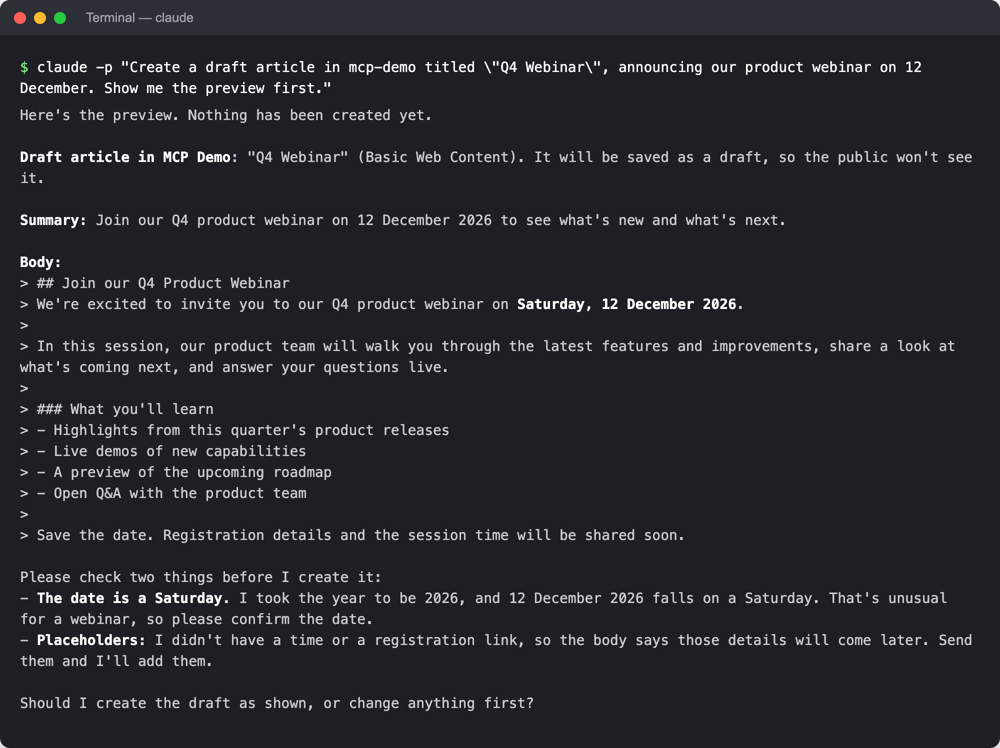

# Writes and Previews
{: .no_toc }

The server never changes anything without a person seeing the change first. This page explains the safeguards, from Liferay's own permissions to the audit log.

1. TOC
{:toc}

## What Can Change

Three things decide it, and each can only narrow the others:

1. **The service user's roles** in Liferay: what it may do in each site.
1. **The OAuth application's scopes:** with read-only scopes, Liferay refuses every write, and the server shows the write tools as unavailable.
1. **The server's write mode,** `MCP_WRITE_MODE`:
    - `off`, the default: write tools refuse, and show the request they would have sent.
    - `confirm`: every write is previewed, and runs only once it's confirmed.

Deletes, batches of changes and permission changes also need `MCP_DESTRUCTIVE_WRITES=true`. Writes in administration areas, such as users and roles, need `MCP_ADMIN_WRITES=true`.

## Preview and Confirm

With `confirm`, the first call to a write tool returns a **preview**: the item before and after, and the exact request to Liferay. Nothing changes yet. The AI assistant shows it to you, and only when you agree does it call the tool again to confirm.

For example, Claude Code asked for a draft article shows what it would create, and asks before it creates it:

{: .screenshot }

A confirmation works once, and only for that exact change. If the item was edited in the meantime, or the server restarted, it no longer works, and the assistant asks for a fresh preview.

## Publishing and Review

A confirmed article change publishes it, unless the site has a review workflow for web content: then it's submitted for review. The result says which. Ask for a draft to save without publishing, and to publish it later.

## The Audit Log

Every write attempt, whether refused, previewed, run, or failed, is added to the server's audit log, `/data/logs/audit.jsonl` in the container, with who asked and what was sent.

## Related Information

- [Settings](../reference/settings.html)
