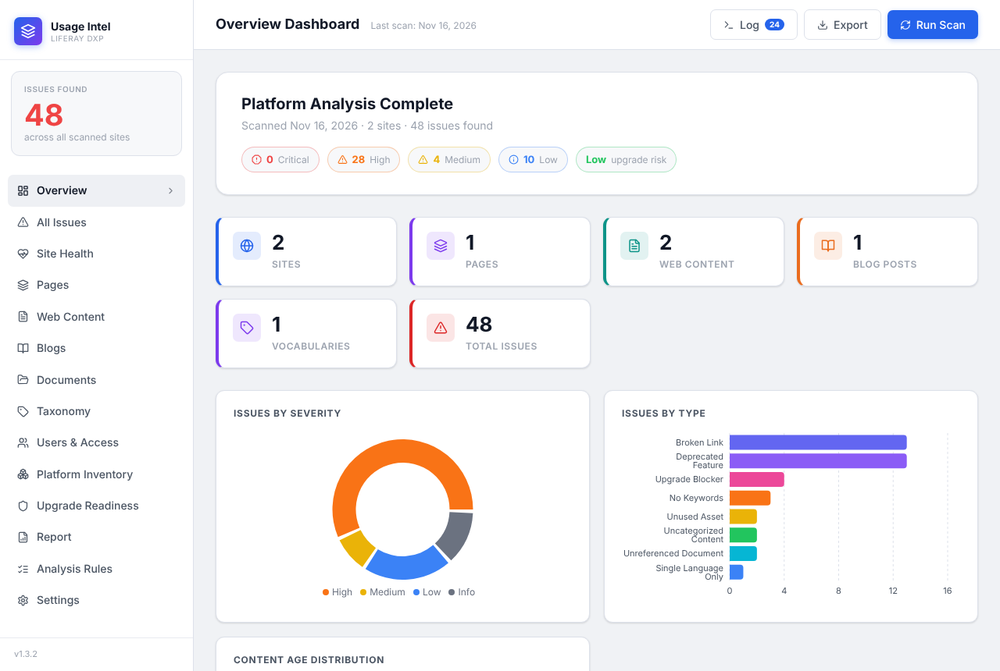
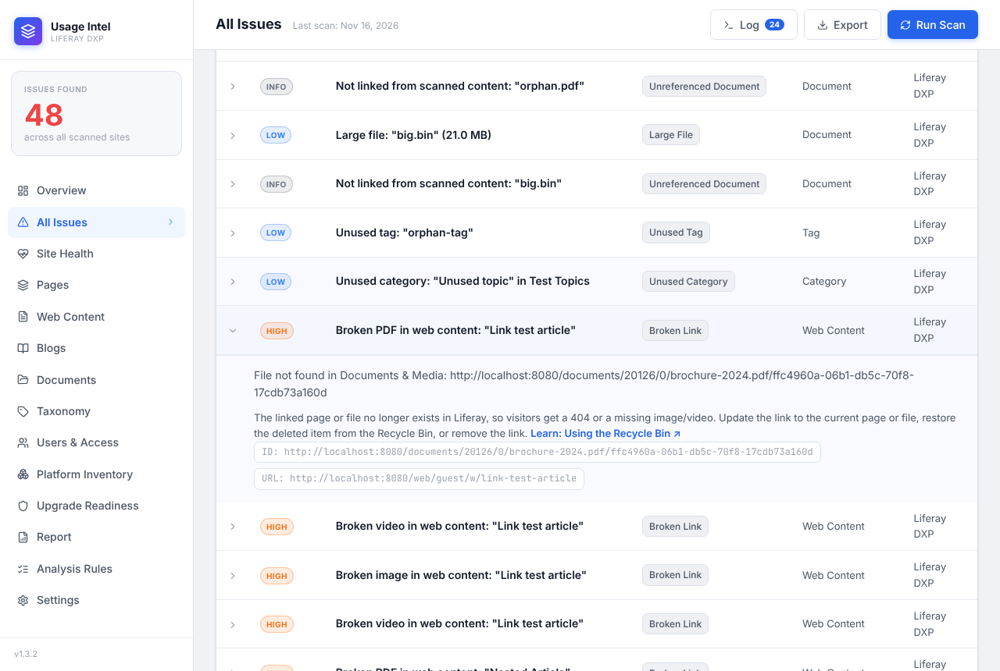
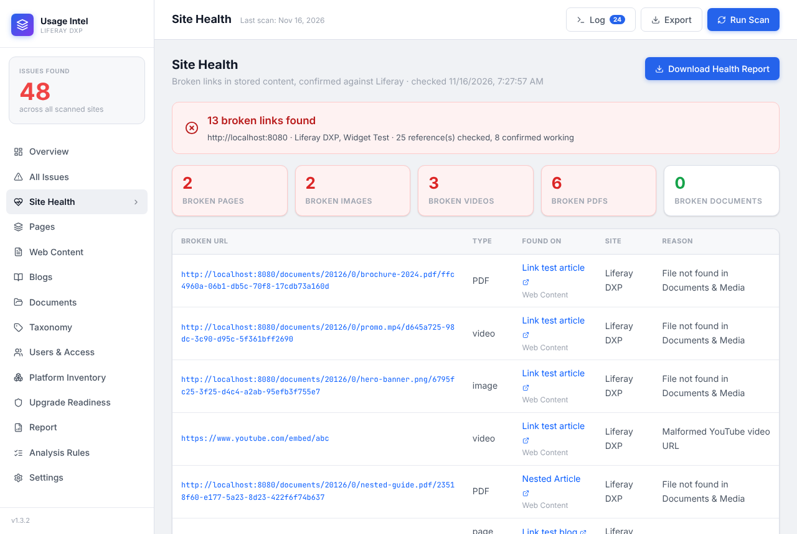
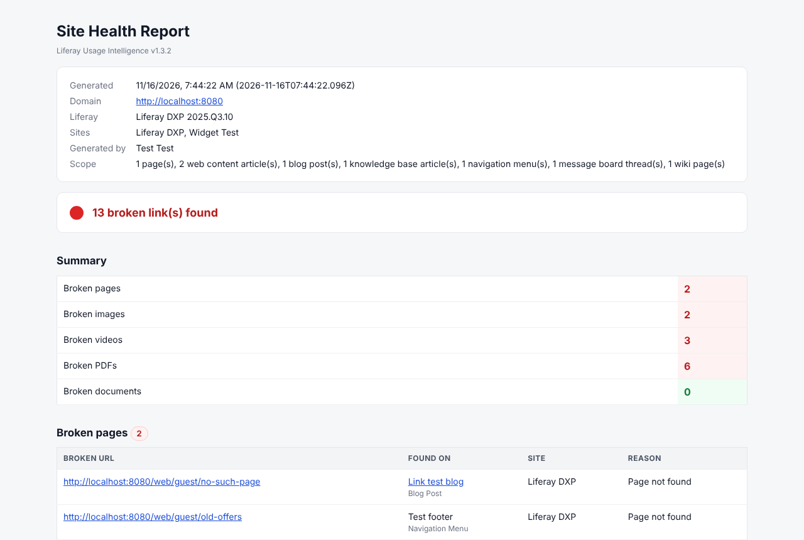
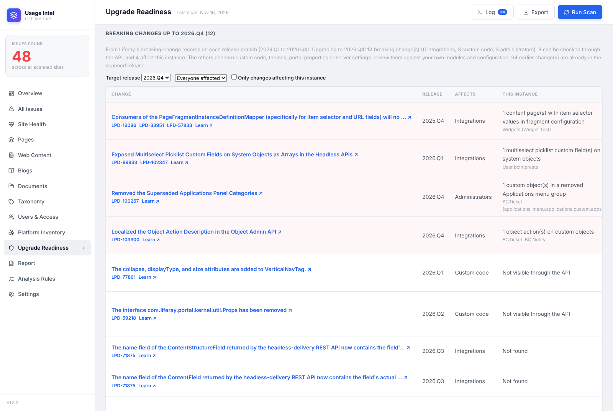

# Using the Dashboard
{: .no_toc }

1. TOC
{:toc}

## Running a Scan

Open the dashboard and click **Run Scan**. A scan reads every site you can see, except the *Usage Intelligence* site itself, and usually takes seconds to a few minutes. The scan log lists each step, and a **WARN** line for any API this release doesn't offer or you can't read, so a partial scan says what it skipped. Results stay in the browser tab until you close it.

## What You See

| Page | What it shows |
| --- | --- |
| **Overview** | A health score from 0 to 100, issues by severity and type, and a per-site heat map. |
| **Issues** | Every finding, filterable, each with a recommendation and a Liferay Learn link. |
| **Site Health** | Broken page links, images, videos and PDFs, where they were found, and a downloadable HTML report. |
| **Upgrade Readiness** | Breaking changes and deprecations for your release (see below), and an upgrade risk score. |
| **Pages, Web Content, Blogs, Documents, Taxonomy** | Each content area with its own findings. |
| **Users & Access** | Dormant, never-used and administrator accounts. |
| **Platform Inventory** | Counts per site and across the instance: content, members, user groups, organizations, roles, workflow, forms and custom objects. |
| **Rules** | Every check the app runs, its severity and what triggers it. |
| **Report** | JSON and CSV export. |

{: .screenshot }

Click any finding to see what was found, how to fix it, and the Liferay Learn article that explains the fix:

{: .screenshot }

## Site Health

The scan collects every link, image, video and embed in stored content, then checks each target with Liferay. A link is reported as broken only when Liferay confirms the page or file doesn't exist, because Liferay's lists come from the search index, which can be incomplete. Links to other websites and YouTube availability aren't checked; they're counted as "not checked".

{: .screenshot }

**Download Health Report** saves a self-contained HTML file with the date, domain, sites, overall status, and every broken URL with the page or content it was found on. It opens offline and can be emailed or archived:

{: .screenshot }

## Upgrade Readiness

Pick the release you plan to upgrade to. The page then lists:

- **Breaking changes** between your release and that one, from Liferay's own breaking-change records, with who each affects: integrations, administrators or custom code. Where the APIs show it, each is checked against your data; for example, multiselect picklist custom fields on system objects, object actions, or custom objects in Applications menu groups that a later release removes. A change that affects your instance becomes an upgrade blocker and counts toward the risk score.
- **Deprecated and maintenance-mode features** from Liferay Learn, placed against your release and checked for use: message boards, wiki, segments, widget pages, and deprecated widgets such as Media Gallery or classic Search on content pages.

{: .screenshot }

Changes to custom code, themes, portal properties or server settings can't be seen through the APIs, so they're listed for you to review against your own modules and configuration.
